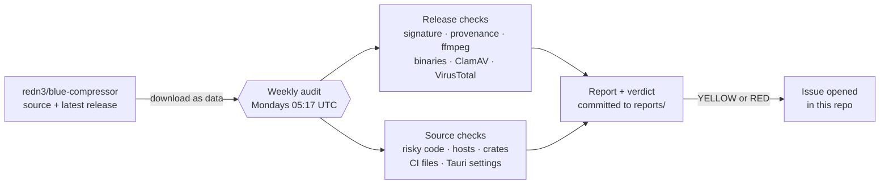

<!--
  DESIGN LOCKED (2026-11-07). Keep this layout when you edit the README:
  1. Centered header: title, one-line tagline, three badges (latest verdict, workflow, upstream).
  2. "Latest result": the table between the status markers. Only scripts/readme_status.py writes it.
  3. "How it works": one Mermaid flowchart.
  4. "What it checks": two tables (Release, Source) with a "Fails as" column.
  5. "Verdicts", "Check your own copy", "Run it yourself", "Limits", "About", in this order.
  Rules: no emoji outside the status table, the verdict table and the "Fails as" column;
  short sentences; no personal names. Change the design only on purpose, and update this note.
-->

<div align="center">

# Blue Compressor · Independent Malware Audit

**A weekly, read-only check that the Blue Compressor app you download is the app its source says it is.**

[](reports/)
[](https://github.com/alperkaganavci/blue-compressor-audit/actions/workflows/audit.yml)
[](https://github.com/redn3/blue-compressor)

[Latest reports](reports/) · [Method](scripts/audit.py) · [Workflow](.github/workflows/audit.yml) · [Upstream project](https://github.com/redn3/blue-compressor)

</div>

[Blue Compressor](https://github.com/redn3/blue-compressor) shrinks raw R3D and N-RAW camera footage, so people install it on the machines that hold their originals. This repo checks every week that the release is genuine and that the app does nothing it should not. It never builds, runs or installs upstream code, and it never writes to upstream.

> [!NOTE]
> This is an independent community contribution. It is not affiliated with the Blue Compressor project.

## Latest result

<!-- status:start -->

| Check | Result |
|---|---|
| Verdict | 🟢 **GREEN** |
| Release | [`v1.0.1`](https://github.com/redn3/blue-compressor/releases/tag/v1.0.1) · macOS Apple silicon |
| Updater signature | ✅ verified |
| Bundled ffmpeg | ✅ byte-identical |
| Built by | ✅ upstream `release.yml`, run 42587861297 |
| ClamAV | ✅ clean (3628258 signatures) |
| VirusTotal (detections/engines) | [app 0/61](https://www.virustotal.com/gui/file/80180a582a610912c321ee45e589672b2f9ed6e5ea0a3bd1fe934c5201a42555) · [dmg 0/61](https://www.virustotal.com/gui/file/6702056545bffc1fd6caa578689ae172b16a77039121ad43022bb8d80a6be985) · [cli 0/61](https://www.virustotal.com/gui/file/c495c94950cafde13ba61a35c76b1ad8b1a53803a1db31461ac65a4947b7cd03) |
| Source checked | [`8f27d72`](https://github.com/redn3/blue-compressor/commit/8f27d7225ef55c6a306a3814de33df7f42cc8160) on `main` |
| Checked | 2026-11-09 · [full report](reports/2026-11-09.md) |

<!-- status:end -->

## How it works



## What it checks

**Release** (what users install; macOS Apple silicon today)

| Check | How | Fails as |
|---|---|---|
| Provenance | Every asset was uploaded by `github-actions[bot]` during a successful `release.yml` run for the tag's commit, and the tag is on `main`. | 🔴 / 🟡 |
| Integrity | Each download matches the sha256 digest GitHub lists. | 🔴 |
| Updater signature | The `.app.tar.gz` verifies with minisign against the key in `tauri.conf.json`, and that key matches `main`. | 🔴 |
| Updater feed | `latest.json` points only at upstream release URLs, with the same signature as the `.sig` asset. | 🔴 |
| Bundled ffmpeg | Byte-identical to the build `release.yml` downloads, from an allowed host. | 🔴 |
| App bundle | One `.app` folder, no duplicate or odd paths, no setuid files, no links outside the bundle, only the two expected executables. | 🔴 / 🟡 |
| Binaries | Linked libraries and URL hosts in the app and CLI binaries, compared with the reviewed baseline. | 🟡 |
| Antivirus | ClamAV scans every file. VirusTotal scans the app, DMG and CLI with about 60 engines (new files are uploaded). | 🔴 / 🟡 |

**Source** (what the next release will contain)

| Check | How | Fails as |
|---|---|---|
| Risky code | Network, process, persistence, secrets, obfuscation and dynamic-code tokens, counted per file against the baseline. Tests and examples are skipped. | 🟡 |
| Hosts and blobs | URL hosts, binary or packed files and long base64 strings in tracked files. | 🟡 |
| Supply chain | Crate names in `Cargo.lock`; any crate not from crates.io; RustSec advisories that mark a crate as malicious. | 🔴 / 🟡 |
| Build and CI | Build scripts, workflow files and commit authors. | 🟡 |
| Tauri security | Updater key and endpoint, CSP and permissions. A changed updater key or endpoint is red. | 🔴 / 🟡 |

## Verdicts

| | Verdict | Meaning | What to do |
|---|---|---|---|
| 🟢 | **GREEN** | No sign of malware or tampering. | Nothing. |
| 🟡 | **YELLOW** | Something changed that a person must read. It is not proof of malware. | Read the yellow lines. If they are fine, run the workflow with `accept_baseline: true`. |
| 🔴 | **RED** | A check that protects against malware or tampering failed. | Do not install or update until the report is understood. |

## Check your own copy

On a Mac with Blue Compressor installed:

```bash
git clone https://github.com/alperkaganavci/blue-compressor-audit.git
cd blue-compressor-audit
scripts/check-installed.sh
```

It hashes every file in `/Applications/Blue Compressor.app`, compares them with the manifest of the same version in [`manifests/`](manifests/), and runs `codesign --verify --deep --strict`.

## Run it yourself

```bash
brew install minisign clamav cargo-audit
scripts/run-local.sh            # latest release
scripts/run-local.sh v0.3.6     # a specific release
```

## Limits

- The main binary is not rebuilt to prove it matches the source, because the build is not reproducible yet. The audit shows it came from the public workflow, carries the upstream signature and did not change after the build.
- Upstream ships the macOS app ad-hoc signed and not notarized, so Gatekeeper rejects it. That is expected and not a finding.
- Only the macOS Apple silicon build is inspected. Windows and Linux are not, yet.
- The first baseline was reviewed by hand on 2026-11-07 against upstream `4d35f31` and release v1.0.0.

## About

Reports and findings are committed by the workflow, so the history of this repo is the audit log. Issues and suggestions are welcome.
